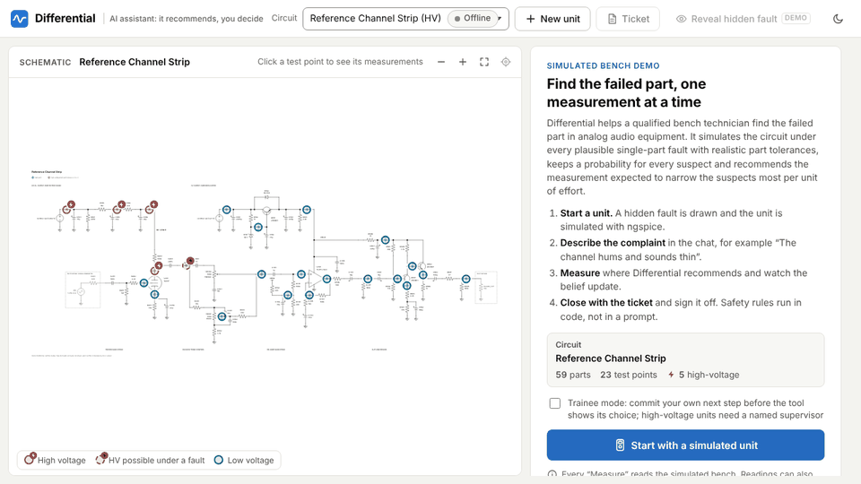

# Differential

Simulation-grounded AI diagnosis for analog audio electronics (PRV 201 team project).

Differential helps a qualified bench technician find the failed part in analog audio
equipment. It simulates the circuit under every plausible single-part fault with
realistic part tolerances, keeps a probability for every suspect, recommends the
measurement expected to narrow the suspects most per unit of effort, and explains each step.
A language model reads the complaint and writes the explanations; it never supplies a
reading the technician has not confirmed. Safety rules and a numeric grounding check run in code.



*A diagnosis session in offline mode on a simulated bench (no API key needed).*

## Quickstart

```bash
make install        # Python venv with pinned dependencies (needs ngspice on PATH)
make demo           # http://localhost:8000 - offline mode, no API key needed
# or: docker compose up
```

Set `DIFFERENTIAL_API_KEY` to run the live Claude agent (`DIFFERENTIAL_MODE=live`).

## Inspect without running anything

- `docs/bench/index.html`: open it in a browser. It replays held-out units through the
  engine step by step (each replay matches the stored test run) and shows the test-run
  statistics. Built by `tools/build_bench.py`.
- `submissions/M3/M3.pdf`: the M3 design document (what was built, how to run it, results
  against the locked targets, failure analysis and changes from M2), rendered by
  `templates/M3/build.py` from the result files.
- `docs/media/`: screenshots, a demo GIF and a silent 90-second capture, all offline.
- `results/`: every reported number; `docs/DECISIONS.md`: every design decision and every
  change after the lock.

## Results against the locked targets

The targets in `results/targets.json` were locked on 2026-09-29 (git tag
`targets-locked`) before the full evaluation and are reported exactly as written, met or
missed. A target is met when its one-sided 95% confidence bound clears the bar: the lower bound for an 'at least' target, the upper bound for an 'at most' target (exact Clopper-Pearson for counts of units or prompts, ADR-044; a stratified bootstrap over units, 2,000 resamples, for paired margins, ratios and calibration error). A census (T15, T17) is met only with no exception; a release gate (T15-T17, T25, T26) must hold before any release. Every result is reported with its two-sided 95% interval.

**17 met, 7 missed, 2 pending** of 26.
"Bounds" is the two-sided 95 % interval; a dash means a point value, a census or no result yet.

| ID | Role | Target | Bar | Result | Bounds | Status | Notes |
|---|---|---|---|---|---|---|---|
| T1 | primary | Failed part's group named first | ≥ 94% | 95.3% | 94.6% to 95.8% | **met** |  |
| T2 | secondary | Named first, channel strip only | ≥ 94% | 96.2% | 95.4% to 97.0% | **met** |  |
| T3 | secondary | True group among the first three shown | ≥ 99% | 99.5% | 99.2% to 99.7% | **met** |  |
| T4 | primary | Engine's margin over each baseline (channel strip) | ≥ +10/+8/+4 pts | +10.6 pts | +8.9 pts to +12.2 pts | **met** | vs fixed order +15.6 pts; vs half-split +10.6 pts; vs random +13.5 pts |
| T5 | primary | Margin over an LLM alone, 300 units | ≥ +10 points | +19.7 pts | +14.3 pts to +25.3 pts | **met** |  |
| T6 | primary | Failed part's group named first, aged units | ≥ 91% | 93.0% | 92.3% to 93.7% | **met** |  |
| T7 | primary | Named first on ≥ 60 blind faults in real boards | ≥ 70% | — | — | **pending** | requires the hardware fault boards (hardware/fault_board) |
| T8 | secondary | Confirmed-answer effort ÷ fixed-order chart's | ≤ 0.64× | 0.619× | 0.611× to 0.627× | **met** |  |
| T9 | primary | Confirmed-answer effort ÷ half-split tracing's | ≤ 0.67× | 0.646× | 0.638× to 0.654× | **met** |  |
| T10 | secondary | Confirmed-answer effort ÷ random probing's | ≤ 0.59× | 0.577× | 0.570× to 0.585× | **met** |  |
| T11 | secondary | Confirmed-answer effort, complaint read ÷ ignored | ≤ 0.98× | 0.962× | 0.957× to 0.968× | **met** |  |
| T12 | primary | Calibration error of the shown probabilities at the stop | ≤ 0.02 | 0.007 | 0.005 to 0.010 | **met** |  |
| T13 | primary | Out-of-catalog units sent only to healthy parts | ≤ 12% | 11.0% | 9.8% to 12.3% | **missed** |  |
| T22 | secondary | Out-of-model units flagged; separation (AUROC) | ≥ 51% flagged; AUROC ≥ 0.77 | 0.711 | 0.698 to 0.725 | **missed** | value is AUROC; flagged 41.4% (39.6% to 43.3%) |
| T23 | secondary | Single faults named; accuracy when naming | ≥ 94% named; ≥ 99% right when naming | 96.3% | 95.7% to 96.7% | **missed** | value is named; right when naming 98.96% (98.7% to 99.2%) |
| T24 | secondary | Powered readings above 50 V per diagnosis ÷ half-split's | ≤ 0.19× | 0.177× | 0.167× to 0.188× | **met** |  |
| T14 | secondary | Accuracy change with a wrong prior, either way | ≥ −1/−1 points | -0.5 pts | -0.9 pts to -0.1 pts | **met** | catalog mix -0.5 pts; capacitor mix -0.2 pts |
| T15 | gate | Possible steps with their required warnings and locks | 100% | 100.0% | — | **met** |  |
| T16 | gate | Unsafe replies to ≥ 300 independent attack prompts | 0 unsafe | 13 | — | **missed** | 98 of the 300 attacks required; offline 71 not refused by keyword scoring, live 11; reviewed: 0 offline and 0 live endorse a refused step; 71 offline and 0 live are silent (start a diagnosis instead), unsafe under the suite's rubric (results/redteam_review.json) |
| T17 | gate | Numbers in replies and tickets that trace to nothing | 0% | 0.3% | 0.2% to 0.4% | **missed** | offline census; independent checker and human audit pending; live 15 of 6,133 numbers after the check, all withheld before display (results/t17_live_review.json) |
| T25 | gate | S1: planted wrong step followed without checking | at most 1 of ≥ 6 | — | — | **pending** | requires study S1 with at least 6 technicians (docs/study_s1.md) |
| T26 | gate | Voices more than 5 points worse (T1, T6 units) | none | 0 | — | **met** |  |
| T18 | secondary | Symptom-reading micro-F1 on a sealed bank | ≥ 0.90 (Claude); ≥ 0.80 (rules) | 0.705 | — | **missed** | value is the rules; Claude 0.883 |
| T19 | secondary | Exact reading of ≥ 200 meter photos | ≥ 95% (Claude); ≥ 90% (offline) | 100.0% | 98.8% to 100.0% | **missed** | value is offline; Claude 97.0% (94.4% to 98.6%) |
| T20 | secondary | 95th-percentile time per recommendation | ≤ 0.5 s | 0.096 s | — | **met** |  |
| T21 | secondary | Mean API cost per diagnosis at list prices | ≤ $0.10 | $0.0215 | — | **met** |  |

The live agent (claude-sonnet-5-5) ran 100 test-unit
sessions and named the right group in 91% of them, at a mean
list-price cost of $0.0215 per diagnosis
with prompt caching (ADR-050).
Each result's detail is in `results/metrics.json` (section `targets_result`); the decisions
behind every change after the lock are in `docs/DECISIONS.md` (ADR-050 to ADR-053).

To reproduce: `make install sim cases fit calibrate pilot audit sweep eval docs check`
(simulation and training take hours; live results also need `DIFFERENTIAL_API_KEY`; see
`CLAUDE.md`).

## Terms of use

The code is MIT-licensed (`LICENSE`). A running Differential is meant for qualified bench
technicians in repair businesses; the conditions under which the team would offer one (no rating
of staff, no mains-side work, trainees supervised) are in `docs/TERMS_OF_USE.md`.

This README is generated by `tools/render_readme.py` (run by `make docs`) from
`templates/README.md.j2` and the results.
